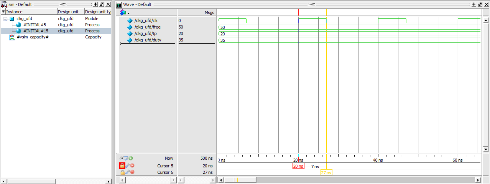

# User-Defined Clock Generation with Variable Duty Cycle using Verilog HDL

## 1. Project Overview

This project demonstrates the design and simulation of a user-defined clock generator with variable frequency and duty cycle using Verilog HDL.

The design allows users to dynamically specify both clock frequency and duty cycle during simulation through the `$value$plusargs` system task.

Based on the user-provided inputs, the clock period, high time, and low time are automatically calculated to generate the desired clock waveform without modifying the Verilog source code.

The design is developed using GVim and simulated using ModelSim 2020.1.

## 2. Tools and Technologies

- **Hardware Description Language:** Verilog HDL
- **Simulation Tool:** ModelSim 2020.1
- **Code Editor:** GVim
- **Simulation Automation:** ModelSim DO Script

## 3. Project Files

| File Name | Description |
|---|---|
| `clkg_ufd.v` | Verilog source code for variable frequency and duty cycle clock generation |
| `run.do` | ModelSim automation script |
| `waveform_zoomed.png` | Zoomed clock simulation waveform |
| `waveform_full.png` | Full simulation waveform |
| `README.md` | Project documentation |

## 4. Working Principle

1. The user provides the desired clock frequency through the `freq` runtime argument.
2. The user provides the desired duty cycle through the `duty` runtime argument.
3. The `$value$plusargs` system task reads both input parameters during simulation.
4. The clock period is calculated based on the specified frequency.
5. The high and low durations are calculated using the specified duty cycle.
6. A `forever` loop continuously generates the clock waveform with the desired timing characteristics.
7. The simulation terminates after 500 ns using the `$finish` system task.

## 5. Mathematical Formulation

### Clock Period

\[
T = \frac{1}{f}
\]

For frequency in MHz and time period in ns:

\[
T(ns) = \frac{1000}{f(MHz)}
\]

### High Time

\[
T_{HIGH} = \frac{Duty\ Cycle}{100}\times T
\]

### Low Time

\[
T_{LOW} = \frac{100-Duty\ Cycle}{100}\times T
\]

### Duty Cycle

\[
Duty\ Cycle(\%) =
\frac{T_{HIGH}}{T}\times100
\]

## 6. Simulation Parameters

The following input parameters were used in the ModelSim simulation:

| Parameter | Value |
|---|---:|
| Input Frequency | 50 MHz |
| Input Duty Cycle | 35% |
| Clock Period | 20 ns |
| High Time | 7 ns |
| Low Time | 13 ns |
| Simulation Duration | 500 ns |

### Calculation

For an input frequency of 50 MHz:

\[
T = \frac{1000}{50}=20\ ns
\]

For a duty cycle of 35%:

\[
T_{HIGH} = \frac{35}{100}\times20=7\ ns
\]

\[
T_{LOW} = \frac{65}{100}\times20=13\ ns
\]

Therefore, the generated clock has a 20 ns time period, with 7 ns high time and 13 ns low time.

## 7. ModelSim Simulation Procedure

### Step 1: Compile the Verilog Design

```tcl
vlog clkg_ufd.v -l comp.log
```

### Step 2: Elaborate and Load the Design

```tcl
vsim -voptargs=+acc clkg_ufd +freq=50 +duty=35
```

### Step 3: Add Signals to the Waveform Window

```tcl
add wave sim:/clkg_ufd/*
```

### Step 4: Run the Simulation

```tcl
run -all
```

## 8. Simulation Automation Using run.do

The `run.do` script automates the ModelSim simulation process.

It performs the following operations:

- Compilation of the Verilog source file.
- Loading and elaboration of the design.
- Passing user-defined frequency and duty cycle values.
- Adding design signals to the waveform viewer.
- Executing the simulation.

To execute the complete simulation automatically, enter:

```tcl
do run.do
```

## 9. Simulation Results

The following waveforms demonstrate clock generation with an input frequency of 50 MHz and a duty cycle of 35%, simulated using ModelSim 2020.1.

### 9.1 Zoomed Clock Waveform

The zoomed waveform illustrates the high and low transition intervals of the generated clock signal.

<p align="center">
  
</p>

<p align="center">
  <b>Figure 1: Zoomed ModelSim waveform showing the 7 ns high-time interval and 13 ns low-time interval.</b>
</p>

### 9.2 Full Simulation Waveform

The following waveform demonstrates continuous clock generation throughout the 500 ns simulation duration.

<p align="center">
  
</p>

<p align="center">
  <b>Figure 2: Full ModelSim simulation waveform showing continuous clock generation over 500 ns.</b>
</p>

### Waveform Observations

- Input frequency = 50 MHz.
- Clock period = 20 ns.
- High duration = 7 ns.
- Low duration = 13 ns.
- Duty cycle = 35%.
- Continuous clock generation throughout the simulation.

The simulation results verify the generation of a clock signal with user-defined frequency and duty cycle.

## 10. Key Verilog Concepts Used

- `$value$plusargs` system task
- Real data type
- Initial procedural block
- `forever` loop
- Delay control
- Runtime parameter passing
- Clock period calculation
- Variable duty cycle generation
- `$finish` system task

## 11. Learning Outcomes

- Understanding clock generation using Verilog HDL.
- Implementing runtime-configurable frequency and duty cycle.
- Understanding clock period and duty cycle calculations.
- Using `$value$plusargs` for dynamic simulation parameters.
- Automating simulation using ModelSim DO scripts.
- Verifying clock timing characteristics through waveform analysis.

## 12. Author

M.Tech VLSI Design Student
