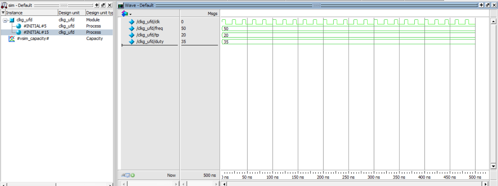

# User-Defined Clock Generation with Variable Duty Cycle using Verilog HDL

<p align="center">
  <b>Verilog HDL | ModelSim 2020.1 | GVim</b>
</p>

---

## 1. Project Overview

This project focuses on the design and simulation of a **User-Defined Clock Generator with Variable Duty Cycle** using Verilog Hardware Description Language (HDL).

The design allows the user to specify the clock frequency and duty cycle through runtime parameters. Based on the user-defined inputs, the clock generator produces a periodic digital clock signal with the corresponding HIGH and LOW durations.

The project demonstrates the fundamental concepts of clock generation, frequency control, time-period calculation, and duty-cycle variation in digital systems.

## 2. Objectives

- To design a user-defined clock generator using Verilog HDL.
- To generate clock signals with a user-defined frequency.
- To understand and implement variable duty-cycle control.
- To calculate the HIGH and LOW time intervals of a clock signal.
- To simulate and verify the generated clock waveform using ModelSim.
- To understand the relationship between frequency, time period, and duty cycle.

## 3. Tools and Technologies

| Tool / Technology | Description |
|:---|:---|
| Verilog HDL | Hardware Description Language used for design |
| ModelSim 2020.1 | HDL compilation and simulation |
| GVim | Verilog source-code editing |
| Windows / Linux | Development environment |

## 4. Repository Structure

The repository contains the following files:

```text
User-Defined-Clock-Generation-Variable-Duty-Cycle/
│
├── clkg_ufd.v
├── run.do
├── waveform_zoomed.png
├── waveform_full.png
└── README.md
```

| File Name | Description |
|:---|:---|
| `clkg_ufd.v` | Verilog HDL source code for clock generation |
| `run.do` | ModelSim simulation and execution script |
| `waveform_zoomed.png` | Zoomed view of the generated clock waveform |
| `waveform_full.png` | Complete simulation waveform |
| `README.md` | Project documentation |

## 5. Design Specifications

The following values are used for the example simulation:

| Parameter | Value |
|:---|---:|
| Clock Frequency | 50 MHz |
| Clock Period | 20 ns |
| Duty Cycle | 35% |
| HIGH Duration | 7 ns |
| LOW Duration | 13 ns |
| Simulation Time | 500 ns |

## 6. Theoretical Background

### 6.1 Clock Signal

A clock signal is a periodic digital waveform that alternates between logic HIGH (1) and logic LOW (0). It provides timing and synchronization for digital circuits and sequential systems.

### 6.2 Clock Frequency

Clock frequency represents the number of complete clock cycles occurring in one second. It is measured in Hertz (Hz).

\[
f=\frac{1}{T}
\]

Where:

- \(f\) = Clock frequency
- \(T\) = Time period

### 6.3 Time Period

The time period is the time required to complete one full clock cycle.

\[
T=\frac{1}{f}
\]

For a clock frequency of 50 MHz:

\[
T=\frac{1}{50\times10^6}
\]

\[
\boxed{T=20\ ns}
\]

### 6.4 Duty Cycle

Duty cycle represents the percentage of one clock period during which the clock signal remains at logic HIGH.

\[
Duty\ Cycle=\frac{T_{ON}}{T}\times100
\]

Where:

- \(T_{ON}\) = HIGH time
- \(T_{OFF}\) = LOW time
- \(T\) = Total clock period

The HIGH duration is calculated as:

\[
T_{ON}=\frac{Duty\ Cycle}{100}\times T
\]

The LOW duration is calculated as:

\[
T_{OFF}=T-T_{ON}
\]

For a 35% duty cycle and a 20 ns clock period:

\[
T_{ON}=0.35\times20=7\ ns
\]

\[
T_{OFF}=20-7=13\ ns
\]

Therefore, the generated clock has a HIGH duration of 7 ns and a LOW duration of 13 ns.

## 7. Design Methodology

The clock generation process follows these steps:

1. Read the user-defined clock frequency.
2. Read the user-defined duty-cycle value.
3. Calculate the clock time period.
4. Calculate the HIGH duration using the duty-cycle percentage.
5. Calculate the LOW duration using the remaining clock period.
6. Generate the clock waveform by applying the calculated HIGH and LOW delays.
7. Continue clock generation until the simulation finishes.

## 8. Simulation Setup

### 8.1 ModelSim Commands

The following commands can be executed in the ModelSim Transcript window:

```tcl
vlog clkg_ufd.v -l comp.log
vsim -voptargs=+acc clkg_ufd +freq=50 +duty=35
add wave sim:/clkg_ufd/*
run -all
```

### 8.2 Command Description

| Command | Function |
|:---|:---|
| `vlog` | Compiles the Verilog source file |
| `vsim` | Loads the design for simulation |
| `+freq=50` | Provides the clock frequency as a runtime parameter |
| `+duty=35` | Provides the duty cycle as a runtime parameter |
| `add wave` | Adds design signals to the waveform window |
| `run -all` | Executes the simulation |

## 9. Simulation Results

### 9.1 Zoomed Simulation Waveform

The zoomed waveform is used to observe the individual HIGH and LOW durations of the generated clock signal.

<p align="center">
  
</p>

<p align="center">
  <b>Figure 1: Zoomed ModelSim Simulation Waveform showing the variable duty-cycle clock.</b>
</p>

### 9.2 Full Simulation Waveform

The full waveform illustrates the periodic clock generation throughout the simulation duration.

<p align="center">
  
</p>

<p align="center">
  <b>Figure 2: Full ModelSim Simulation Waveform.</b>
</p>

## 10. Calculated and Expected Results

For the example input of 50 MHz frequency and 35% duty cycle:

| Parameter | Calculated Value |
|:---|---:|
| Frequency | 50 MHz |
| Time Period | 20 ns |
| Duty Cycle | 35% |
| HIGH Time | 7 ns |
| LOW Time | 13 ns |
| Number of Clock Cycles in 500 ns | 25 |

The generated waveform should exhibit a 20 ns clock period, with the signal remaining HIGH for 7 ns and LOW for 13 ns in every complete cycle.

## 11. Key Observations

- The clock frequency determines the total clock period.
- Duty-cycle variation changes the HIGH and LOW durations without changing the total clock period.
- A 35% duty cycle means that the clock remains HIGH for 35% of the total period.
- The remaining 65% of the period corresponds to the LOW duration.
- ModelSim waveform analysis helps verify the timing characteristics of
